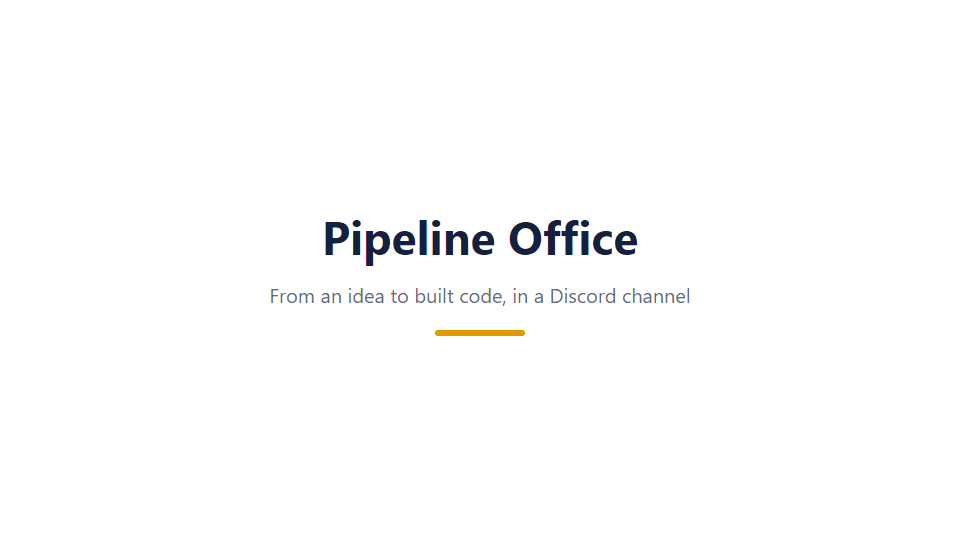
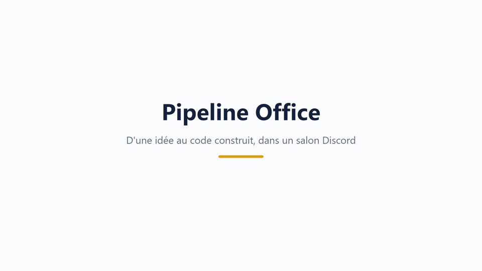

[English](README.md) · **Français**

# Pipeline Office

**Un serveur Discord où un Manager IA menait un projet logiciel de la première idée au code construit, une étape à la fois, une personne cliquant sur « Next step » pour passer à la suivante.**

Animation en français

*Vrais livrables de projets de test, mars et avril 2026. [Vidéo complète (1:20)](https://drive.google.com/file/d/100F2MAstyJsTTwLqoc2QPzl3bRU8SR21/view)*

## Ce qu'on fait avec

- **Un salon par projet.** `/create-project` l'ouvre ; un bot sans modèle de langue demande la langue, puis affiche un bouton Commencer.
- **Un Manager mène.** Il lit l'étape en cours et pose les questions, toujours avec une proposition d'abord, sans jargon.
- **Claude Code fait le travail.** Carte d'architecture, maquettes, histoires d'utilisateur, feuille de route, puis le code, épopée par épopée ; les résultats reviennent dans le salon et les maquettes sont mises en ligne.
- **Vous donnez le rythme.** Une barre de boutons sous chaque réponse : *Je suis perdu*, *Feedback*, *Save checkpoint*, *Next step* (avec une courte notation). `/where` et `/project-memory` disent où on en est ; `/step` saute à une étape.
- **La voix aussi.** `/listen` transcrit la parole en français d'un salon vocal.

## Architecture

Diagramme en français

*Sept étapes : accueil, concept et conception de l'appli, cahier des charges et feuille de route, préparation, construction, rapprochement des histoires, recette et remise.*

## État

- **Arrêté.** Construit du 4 février au 3 avril 2026 (514 commits), sur un PC Windows ; l'arrêt de la passerelle a été décidé le 12 avril 2026.
- **Essayé sur des projets de test.** Un planificateur de Gantt, un gestionnaire de tournois de jeux rétro, une appli web pour un cours d'une journée.
- **Deux architectures.** D'abord un bot par rôle (maquettes, notes, code) ; à partir du 2 avril 2026, une seule session Claude Code par salon les a remplacés.
- **Code privé.** Seule cette vitrine est publique.

---

**Anthony Hunt** · [ingevision.cloud](https://ingevision.cloud/?p=pipeline-office) · [LinkedIn](https://www.linkedin.com/in/anthony-hunt-3948a9196) · [GitHub](https://github.com/anthohunt)
