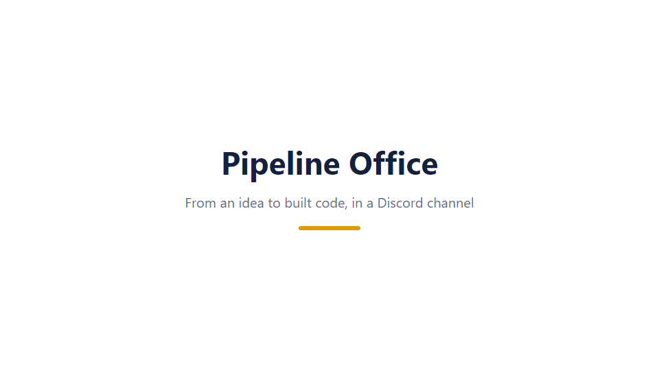

**English** · [Français](README.fr.md)

# Pipeline Office

**A Discord server where an AI Manager walked a software project from the first idea to built code, one step at a time, with a person clicking “Next step” between steps.**

*Real deliverables of test projects, March and April 2026. [Full video (1:20)](https://drive.google.com/file/d/1AgtCbBvHznlDH22xS-a1iaI28_zPqnuS/view)*

## Using it

- **One channel per project.** `/create-project` opens it; a bot with no language model asks the language, then shows a Start button.
- **A Manager leads.** It reads the current step and asks questions, always with a suggestion first, in plain language.
- **Claude Code does the work.** Architecture map, mockups, user stories, roadmap, then the code, epic by epic; results come back in the channel and mockups go online.
- **You set the pace.** A toolbar under each answer: *I'm lost*, *Feedback*, *Save checkpoint*, *Next step* (with a short rating). `/where` and `/project-memory` show where you are; `/step` jumps to a step.
- **Voice works too.** `/listen` transcribes French speech from a voice channel.

## Architecture

*Seven steps: welcome, concept and app design, specifications and roadmap, pre-implementation, build, story reconciliation, QA and handoff. Diagram in French: [architecture.svg](docs/architecture.svg).*

## Status

- **Stopped.** Built from 4 February to 3 April 2026 (514 commits), on a Windows PC; shutting the gateway down was decided on 12 April 2026.
- **Tried on test projects.** A Gantt planner, a retro-gaming tournament manager, a web app for a one-day course.
- **Two architectures.** First one bot per role (mockups, notes, code); from 2 April 2026, a single Claude Code session per channel replaced them.
- **Private code.** Only this showcase is public.

---

**Anthony Hunt** · [ingevision.cloud](https://ingevision.cloud/?lang=en&p=pipeline-office) · [LinkedIn](https://www.linkedin.com/in/anthony-hunt-3948a9196) · [GitHub](https://github.com/anthohunt)
